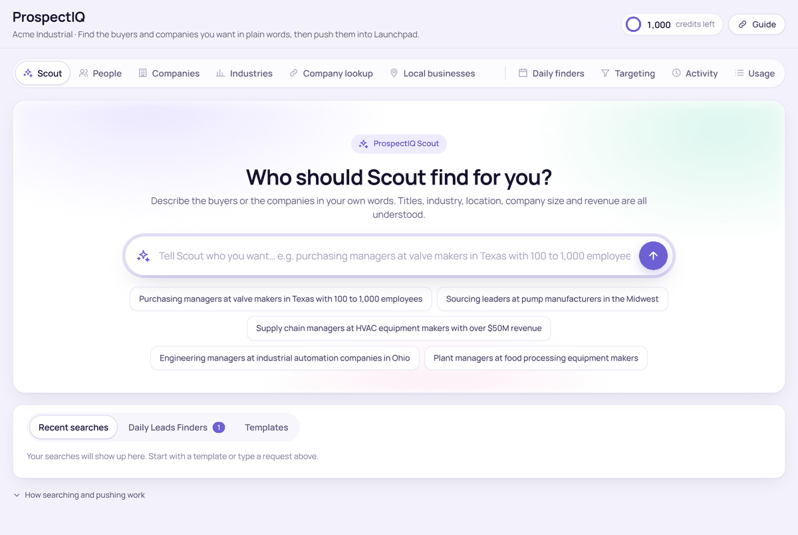
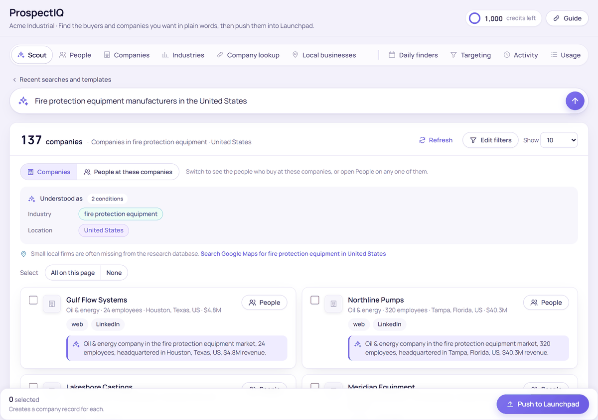
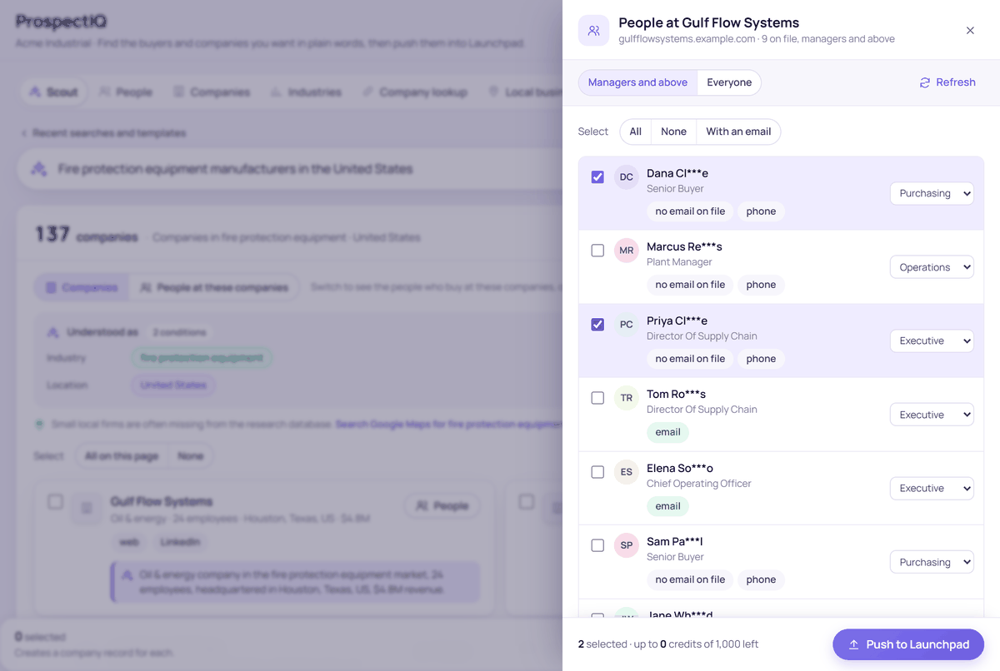
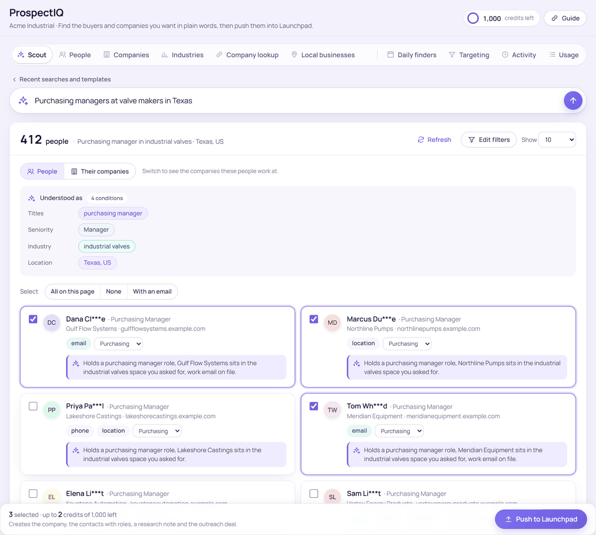
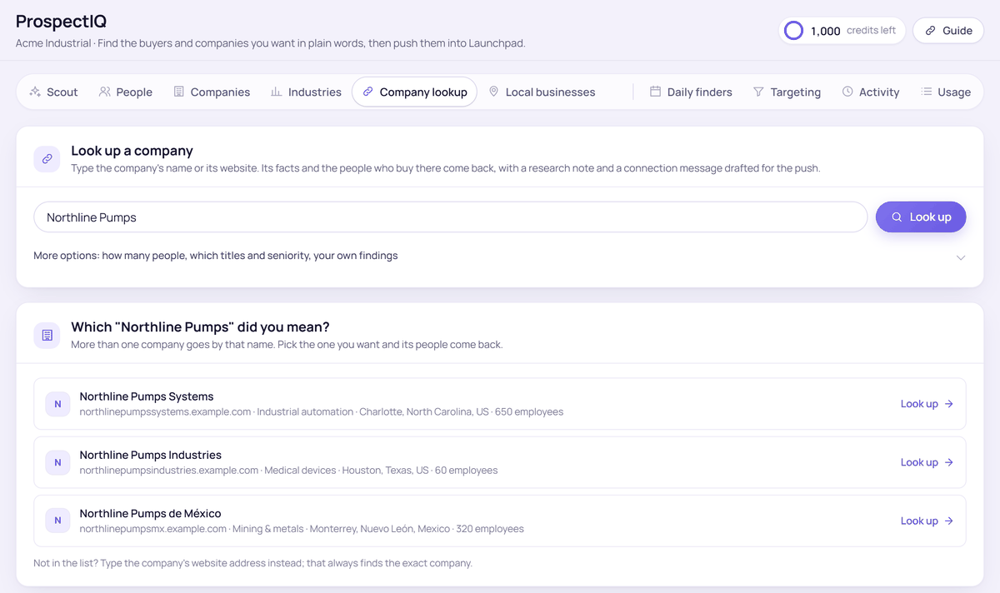
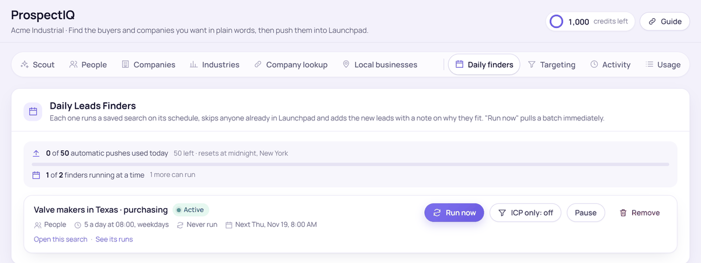

# Client guide

*How to find and push leads with ProspectIQ. Last updated {{updated}}.*

## Opening ProspectIQ

Open it from the **ProspectIQ** link in your Launchpad menu. It signs you in on its own. The header shows your company name, and the credits ring shows how many lookup credits are left this month and when they reset.

If you see "Not switched on for this account yet", your Launchpad team has not set up this account. Tell them the account name.

## Scout

Scout is the first tab and the quickest way to work.

1. Type who you are looking for in your own words. Titles, industry, location, company size and revenue are all understood. Examples: "purchasing managers at valve makers in Texas with 100 to 1,000 employees", "plant managers at food processors in Ohio", "pump manufacturers in Pennsylvania".
2. Press the arrow. The results arrive with a row of **Understood as** chips showing how your request was read.
3. If the reading is off, click **Edit filters** to open the same search on the People or Companies tab with every condition laid out, or click the search box and rephrase.

Under the search box, **Recent searches**, **Daily Leads Finders** and **Templates** give you a head start. Templates are ready-made requests your Launchpad team wrote for your business.

The list of results appears first; the one-line reasons under each result are written a few seconds later and fill in on their own.

If nothing matches every condition in your request, Scout loosens one thing at a time (a department, then the seniority, then the company size, then the place) and tells you in a yellow note what it changed. The **Understood as** chips always show what was actually searched.

## Nothing you searched is lost

Every search stays as you left it while ProspectIQ is open in your browser tab.

- Go to another tab and come back: the results, your ticks, the roles you set and anything you pushed are still there, with no second wait. Each tab reopens on its last search.
- Click the tab you are already on to start fresh. On Scout, **Recent searches and templates** above the search box does the same.
- **Refresh**, beside the result count, runs the search again. A result older than a minute or so shows how old it is next to the button.
- After a push, the people you pushed show as **already a contact** straight away.
- Kept searches last up to an hour and are cleared when you close the browser tab or sign out.

*The Scout tab before a search. Click a template or type your own request.*

## Reading the results

Each person shows first name, a masked surname, title, company and location, plus pills: **email** when a work email is on file, **phone** and **location** when known, and **already a contact** when the person is in your Launchpad. A one-line reason under each result says why they fit your request.

- **Select**: All, With email, New only, or tick by hand.
- **Hide contacts already in Launchpad** removes those rows so the page shows only new people.
- The **Role** menu on each person sets the Role field on the contact in Launchpad.
- Company results show industry, size, headquarters and revenue. The **People** button on a company lists the people there in a panel beside the results: tick who you want and push, then close the panel and you are back on your search. **Managers and above** is shown first; **Everyone** shows all who are on file.

### Companies or the people at them

A request about companies ("fire protection equipment manufacturers in the United States") comes back as companies. The switch above the results turns the same request into **People at these companies**: the buyers at those companies, by your usual titles, ready to tick and push. A request about people can be switched to **Their companies** the same way. Switching back and forth is instant once each side has loaded.

*Company results. The switch turns them into the people at those companies; People on a card opens that one company.*

*The People panel. Tick, set roles and push here; closing it returns you to the search exactly as it was.*

Under company results, **Search Google Maps for …** carries the same request to the Local businesses tab. Use it for small and local firms, more so outside the United States, where the research database is thinner.

*A search with three matches. The pills under each person show what is on file; the bar at the bottom counts what you ticked and the credits the push can use.*

## Pushing to Launchpad

Tick the people you want and press **Push to Launchpad**. The bar above the button shows how many you picked and how many credits the push can use. ProspectIQ looks each person up for the full name, LinkedIn and work email, then creates the records.

What lands in Launchpad for each company:

- The **company record**.
- A **contact** per person with Role, Industry, Company Size and LinkedIn URL, tagged `research`.
- A **research note** on the first contact: why these people fit, a short company brief and a suggested connection message.
- An **outreach deal** at the first stage of your pipeline.

After the push, a summary lists every company and contact with a link to each record. People already in Launchpad are updated, not duplicated.

## People, Companies and Industries

These tabs expose every filter: titles, seniority, department, person and company locations, company size, revenue, funding, technologies and email status. Use them when a request needs precision Scout cannot read, or when you arrive from **Edit filters**.

- **People** returns decision-makers. **Companies** returns organisations; tick them and push to create company records without contacts, or press **People** on any row to see and push the people there without leaving the list.
- Filters you have typed but not searched yet are kept when you visit another tab. **Clear all** empties them.
- **Industries** shows a size and headquarters breakdown for an industry, with a one-click **find buyers at these companies**.

## Company lookup

Type the company's name or its website address. ProspectIQ returns the company, the people there who match your usual titles, a drafted research note and a connection message. Tick the people you want and push; the first ticked contact gets the note and the deal.

- A **name** that fits more than one company shows the candidates with their website, industry, place and size: pick the one you mean. When one company carries exactly the name you typed, it opens directly and the others stay listed under it.
- A **website address** always finds the exact company, so use it when a name is common or abbreviated.

*A name that fits several companies. Pick one and its people come back.*

- The lookup stays as you left it when you change tabs, the note and message you edited included.

## Local businesses

For hotels, restaurants, clinics, dealers and other local businesses, which the research database describes thinly, this tab searches Google Maps instead. Type what kind of business and where, such as "hotels" in "Miami, FL". Each result shows the category, rating and review count, address, phone and website, twenty a page.

- Tick the businesses you want and **push**: each becomes a company record in Launchpad with its address, rating and website. No credits are spent.
- The **People** button on a business with a website lists the people there in a panel beside the results, ready to tick and push.
- The search, the pages you have opened and your ticks stay as you left them when you change tabs.
- Searches here are free for you. Without a Google Maps key on the account the tab shows sample places.
- The tab is part of your plan; if you do not see it, ask your agency to switch it on.

## Daily finders

A finder is a saved search that runs on its own.

1. Run any search on Scout, then open **Make this a daily finder** under the results.
2. Give it a name, choose **New leads per run**, a **Start date**, a **Run time** and a **Repeat** rule (every day, weekdays only, once a week).
3. Leave **Notify** on to get a message when new leads land. Your Launchpad team sets whether that is SMS, WhatsApp or email.
4. Press **Save as a daily finder**.

The **Daily finders** tab lists them. **Run now** pulls today's batch immediately. Each finder can be paused or removed.

*The Daily finders tab, with the day's automatic-push count and one finder running on weekdays.*

Limits worth knowing:

- All your finders together add up to **{{daily_cap}} automatic pushes a day**, counted in your timezone. When the cap is reached, finders pause until tomorrow.
- Up to **{{max_finders}} finders** can be running at a time. Pause or remove one to add another.
- A finder skips anyone already in Launchpad and only pushes new people, each with a note on why they fit.
- People finders spend up to the chosen number of credits per run. Company finders spend none.

## Targeting

Targeting is part of your plan; if you do not see the tab, ask your agency to switch it on. The **Targeting** tab is where you describe who you most want to reach: job titles or title words, seniority, department, industries, locations, company size, revenue, and anything to exclude (titles, industries, locations, companies). Save it once. From then on:

- Every result on Scout and the filter tabs is checked against it. A lead that meets every condition that could be checked is an **ICP match**, shown as a hot lead and sorted first. A lead that meets at least half is a **target match**, shown as high priority. Hover the pill to see which conditions matched, which did not, and which are not known yet.
- **Select → ICP matches** ticks the hot leads on the page in one go.
- Company size, revenue and industry are confirmed when a lead is revealed during a push, so a target match can become an ICP match at that point.
- In Launchpad each pushed contact gets the fields **ICP Match** (ICP match, Target match or No match), **Lead Priority** (Hot, High or Normal) and **Research Summary**, two or three sentences on who they are and why they fit, plus the tags `icp-match` and `hot-lead`, or `target-match` and `high-priority`. Workflows can route on any of them.
- A daily finder can be set to **only push ICP matches** (the checkbox when you save it, or the ICP only button on the finder). It then skips everything else and reads further pages to fill its count. The Targeting tab has a switch that makes this the default for new finders.

Nothing set on the tab means nothing changes: searches and finders work exactly as before.

## Credits

- Searching is free. A credit is spent only when a person lands in Launchpad as a **new contact with a work email**. Company pushes and updates to existing contacts are free.
- The ring in the header shows credits left and the reset date. Credits reset on the 1st of each month.
- When credits run out, pushes and finders stop until the reset. The message shows who to email for a bigger plan.

## Activity and Usage

- **Activity** lists every push, finder run, search and credit change, newest first, with filters by kind.
- **Usage** shows searches, lookups and credits by day and by feature.

Your Launchpad team can switch these tabs on or off for your account.

## Writing requests that work

- Name the **role** and the **kind of company**: "maintenance managers at paper mills".
- Add a **place** when it matters: a state, a country, or "in the Midwest".
- Add **size** or **revenue** to focus: "100 to 1,000 employees", "over $50M revenue".
- Say what the company **makes or sells** in plain words. Scout searches the words companies are actually filed under: "valve manufacturers" is searched as valves, industrial valves and valve manufacturing; "electrical distributors" as electrical distribution, electrical supplies and electrical wholesale.
- Fewer conditions find more people. Scout loosens an empty search on its own; to choose what is loosened yourself, use **Edit filters**.
- Use the **Not in** idea when needed: "manufacturers in Texas, not Houston".

## When something looks wrong

- **No results**: Scout has already tried without the seniority, the company size and the exact place. Use **Edit filters** to change the industry words or the titles, or **Search Google Maps instead** for local firms.
- **The research database did not answer**: a connection dropped. Press **Refresh** or search again; nothing was spent.
- **Everyone on this page is already in Launchpad**: show them with the switch, or go to the next page.
- **A person has no email pill**: pushing still creates the contact with name, title and LinkedIn; no credit is spent unless an email is found.
- **A finder found nothing**: it only pushes people who are new to your Launchpad. Widen the saved search or create a second finder for a nearby audience.
- **The page says sample data**: the account is in demo mode. Ask your Launchpad team to switch on live research.
