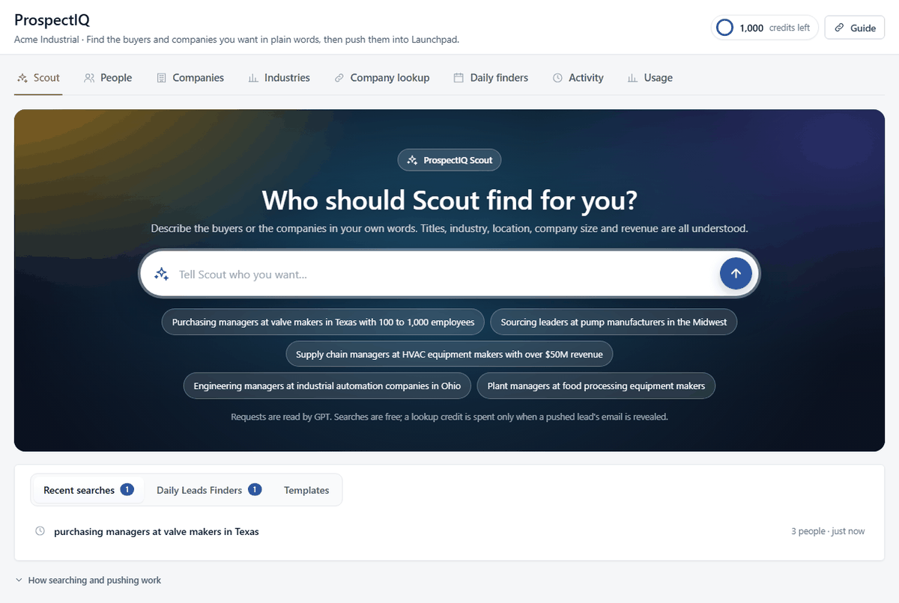
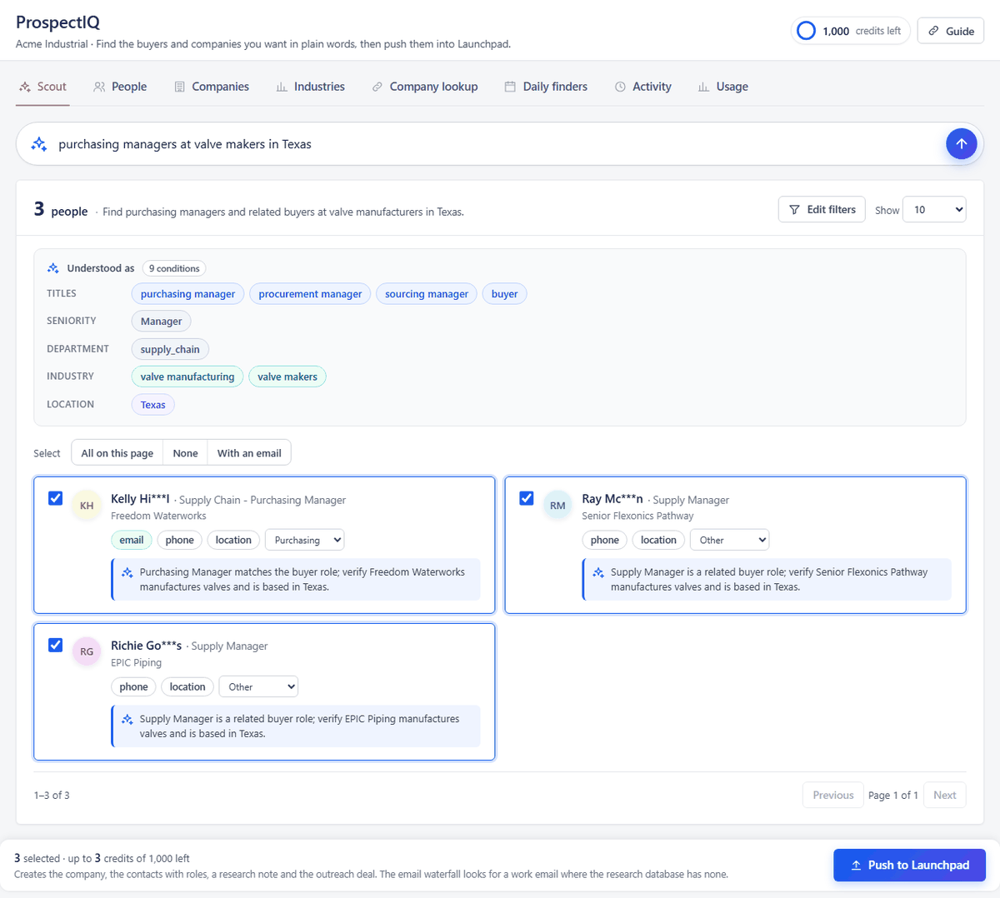
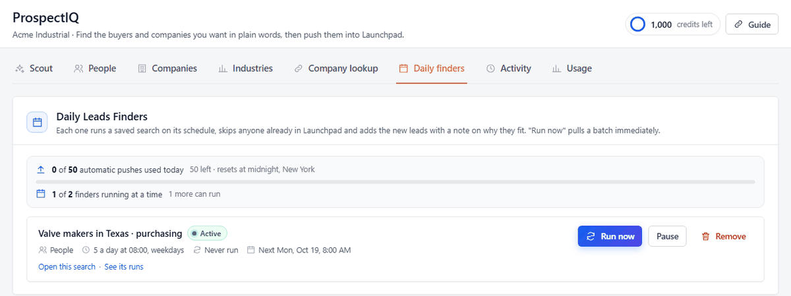

# Client guide

*How to find and push leads with ProspectIQ. Last updated {{updated}}.*

## Opening ProspectIQ

Open it from the **ProspectIQ** link in your Launchpad menu. It signs you in on its own. The header shows your company name, and the credits ring shows how many lookup credits are left this month and when they reset.

If you see "Not switched on for this account yet", your Launchpad team has not set up this account. Tell them the account name.

## Scout

Scout is the first tab and the quickest way to work.

1. Type who you are looking for in your own words. Titles, industry, location, company size and revenue are all understood. Examples: "purchasing managers at valve makers in Texas with 100 to 1,000 employees", "plant managers at food processors in Ohio", "pump manufacturers in Pennsylvania".
2. Press the arrow. The results arrive with a row of **Understood as** chips showing how your request was read.
3. If the reading is off, click **Edit filters** to open the same search on the People or Companies tab with every condition laid out, or click the search box and rephrase.

Under the search box, **Recent searches**, **Daily Leads Finders** and **Templates** give you a head start. Templates are ready-made requests your Launchpad team wrote for your business.

*The Scout tab before a search. Click a template or type your own request.*

## Reading the results

Each person shows first name, a masked surname, title, company and location, plus pills: **email** when a work email is on file, **phone** and **location** when known, and **already a contact** when the person is in your Launchpad. A one-line reason under each result says why they fit your request.

- **Select**: All, With email, New only, or tick by hand.
- **Hide contacts already in Launchpad** removes those rows so the page shows only new people.
- The **Role** menu on each person sets the Role field on the contact in Launchpad.
- Company results show industry, size, headquarters and revenue, with a **people here** link that searches that company's buyers.

*A search with three matches. The pills under each person show what is on file; the bar at the bottom counts what you ticked and the credits the push can use.*

## Pushing to Launchpad

Tick the people you want and press **Push to Launchpad**. The bar above the button shows how many you picked and how many credits the push can use. ProspectIQ looks each person up for the full name, LinkedIn and work email, then creates the records.

What lands in Launchpad for each company:

- The **company record**.
- A **contact** per person with Role, Industry, Company Size and LinkedIn URL, tagged `research`.
- A **research note** on the first contact: why these people fit, a short company brief and a suggested connection message.
- An **outreach deal** at the first stage of your pipeline.

After the push, a summary lists every company and contact with a link to each record. People already in Launchpad are updated, not duplicated.

## People, Companies and Industries

These tabs expose every filter: titles, seniority, department, person and company locations, company size, revenue, funding, technologies and email status. Use them when a request needs precision Scout cannot read, or when you arrive from **Edit filters**.

- **People** returns decision-makers. **Companies** returns organisations; tick them and push to create company records without contacts.
- **Industries** shows a size and headquarters breakdown for an industry, with a one-click **find buyers at these companies**.

## Company lookup

Paste one website address. ProspectIQ returns the company, the people there who match your usual titles, a drafted research note and a connection message. Tick the people you want and push; the first ticked contact gets the note and the deal.

## Daily finders

A finder is a saved search that runs on its own.

1. Run any search on Scout, then open **Make this a daily finder** under the results.
2. Give it a name, choose **New leads per run**, a **Start date**, a **Run time** and a **Repeat** rule (every day, weekdays only, once a week).
3. Leave **Notify** on to get a message when new leads land. Your Launchpad team sets whether that is SMS, WhatsApp or email.
4. Press **Save as a daily finder**.

The **Daily finders** tab lists them. **Run now** pulls today's batch immediately. Each finder can be paused or removed.

*The Daily finders tab, with the day's automatic-push count and one finder running on weekdays.*

Limits worth knowing:

- All your finders together add up to **{{daily_cap}} automatic pushes a day**, counted in your timezone. When the cap is reached, finders pause until tomorrow.
- Up to **{{max_finders}} finders** can be running at a time. Pause or remove one to add another.
- A finder skips anyone already in Launchpad and only pushes new people, each with a note on why they fit.
- People finders spend up to the chosen number of credits per run. Company finders spend none.

## Credits

- Searching is free. A credit is spent only when a person lands in Launchpad as a **new contact with a work email**. Company pushes and updates to existing contacts are free.
- The ring in the header shows credits left and the reset date. Credits reset on the 1st of each month.
- When credits run out, pushes and finders stop until the reset. The message shows who to email for a bigger plan.

## Activity and Usage

- **Activity** lists every push, finder run, search and credit change, newest first, with filters by kind.
- **Usage** shows searches, lookups and credits by day and by feature.

Your Launchpad team can switch these tabs on or off for your account.

## Writing requests that work

- Name the **role** and the **kind of company**: "maintenance managers at paper mills".
- Add a **place** when it matters: a state, a country, or "in the Midwest".
- Add **size** or **revenue** to focus: "100 to 1,000 employees", "over $50M revenue".
- Fewer conditions find more people. If a search comes back empty, drop the size or widen the location first.
- Use the **Not in** idea when needed: "manufacturers in Texas, not Houston".

## When something looks wrong

- **No results**: the request has too many conditions. Use **Edit filters** to loosen one at a time.
- **Everyone on this page is already in Launchpad**: show them with the switch, or go to the next page.
- **A person has no email pill**: pushing still creates the contact with name, title and LinkedIn; no credit is spent unless an email is found.
- **A finder found nothing**: it only pushes people who are new to your Launchpad. Widen the saved search or create a second finder for a nearby audience.
- **The page says sample data**: the account is in demo mode. Ask your Launchpad team to switch on live research.
